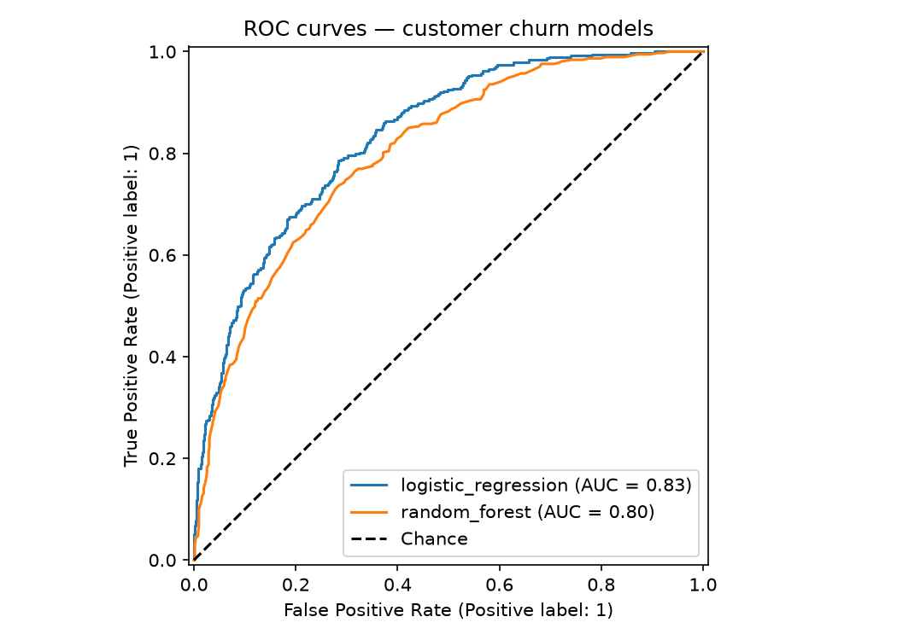
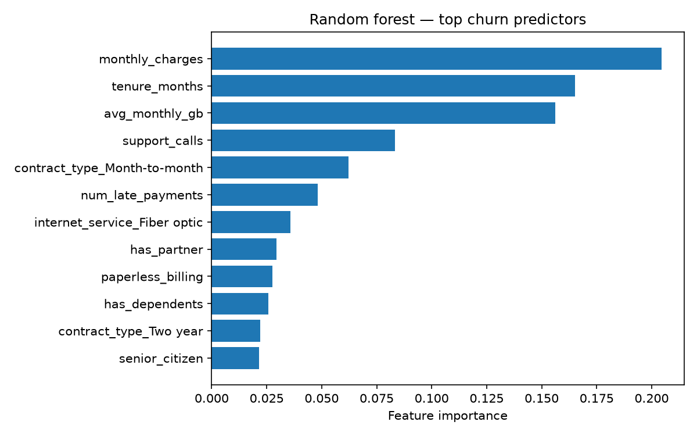

# ChurnPredict — customer churn ML pipeline

**Predict which telecom customers will churn — end to end, with scikit-learn.**

[](https://www.python.org/)
[](https://scikit-learn.org/)
[](#quickstart)
[](LICENSE)

ChurnPredict generates a realistic synthetic telecom-customer dataset with a
known churn mechanism, trains **logistic regression** and **random forest**
classifiers on a stratified split, compares them on precision / recall / F1 /
ROC-AUC, and ships a CLI to score new customers from CSV or JSON. Everything
runs **offline** — no API keys, no network calls, fully seeded and reproducible.

## Screenshots

| ROC curves (both models, real output) | Feature importance (random forest, real output) |
|---|---|
|  |  |

## Features

- **Realistic synthetic data** — 12 customer features (tenure, monthly charges,
  contract type, internet service, support calls, usage, billing, demographics)
  with a plausible logistic churn mechanism; seeded so every run is identical.
- **Two-model training** — logistic regression (interpretable baseline) vs.
  random forest (non-linear challenger), `class_weight="balanced"`, stratified
  80/20 train/test split.
- **Honest evaluation** — accuracy, precision, recall, F1, ROC-AUC, confusion
  matrix and full `classification_report` printed for every model.
- **Explainability** — ROC curve and random-forest feature-importance charts
  saved as PNGs into `docs/`.
- **CLI with three commands** — `train`, `score`, `demo`.
- **Real test suite** — 6 pytest tests covering the generator, training,
  metric ranges, model persistence and single-customer scoring.

## Tech stack

- **Algorithms**: logistic regression, random forest (scikit-learn pipelines)
- **Evaluation**: precision, recall, F1-score, ROC-AUC, confusion matrix
- **Data**: NumPy / pandas synthetic generator (seeded, reproducible)
- **Plots**: matplotlib (Agg backend, headless-safe)
- **Packaging**: pip-installable (`pyproject.toml`), joblib model persistence
- **Tests**: pytest

## Quickstart

```bash
git clone https://github.com/872000/churnpredict.git
cd churnpredict
python3 -m venv .venv
source .venv/bin/activate          # Windows: .venv\Scripts\activate
pip install -r requirements.txt
pip install -e .

# 1. End-to-end demo (~30s): generate data, train, evaluate, save charts + model
python -m churnpredict demo

# 2. Full training run (5,000 customers, plots → docs/, model → models/)
python -m churnpredict train

# 3. Score a new customer from inline JSON (or --json path/to/file.json)
python -m churnpredict score --json '{"tenure_months": 4, "monthly_charges": 89.99, "support_calls": 5, "avg_monthly_gb": 210.5, "num_late_payments": 2, "senior_citizen": 1, "has_dependents": 0, "has_partner": 0, "paperless_billing": 1, "contract_type": "Month-to-month", "internet_service": "Fiber optic", "payment_method": "Electronic check"}'

# 4. Score a batch from CSV (columns must match the 12 features)
python -m churnpredict score --csv customers.csv

# 5. Run the test suite
python -m pytest
```

### Sample results (5,000 customers, seed 42, 37.3% churn rate)

| model | accuracy | precision | recall | F1 | ROC-AUC |
|---|---|---|---|---|---|
| logistic regression | 0.740 | 0.630 | 0.732 | 0.677 | **0.833** |
| random forest | 0.731 | 0.637 | 0.649 | 0.643 | 0.800 |

Top churn predictors (random forest): monthly charges, tenure, usage,
support calls, month-to-month contract — see `docs/feature_importance.png`.

## Project structure

```
churnpredict/
├── src/churnpredict/
│   ├── __init__.py        # public API + version
│   ├── data.py            # seeded synthetic dataset generator
│   ├── features.py        # preprocessing: scaling + one-hot encoding
│   ├── modeling.py        # train, evaluate, plots, model persistence
│   ├── cli.py             # train / score / demo subcommands
│   └── __main__.py        # `python -m churnpredict ...`
├── tests/
│   └── test_churnpredict.py   # 6 pytest tests
├── docs/
│   ├── hero.png               # banner (generated)
│   ├── roc_curve.png          # real model output
│   └── feature_importance.png # real model output
├── models/                # trained model (joblib, gitignored, regenerated)
├── requirements.txt       # pinned dependencies
├── pyproject.toml         # pip-installable package
├── LICENSE                # MIT
└── README.md
```

## Roadmap

- [ ] Hyperparameter tuning with `GridSearchCV` + cross-validation
- [ ] Calibration curves and probability-threshold tuning for business cost trade-offs
- [ ] Permutation importance alongside tree importances
- [ ] Exportable HTML report (metrics + charts in one page)
- [ ] Optional FastAPI scoring endpoint (still offline, local-only)

## License

MIT — see [LICENSE](LICENSE). Copyright (c) 2026 Parth (872000).
